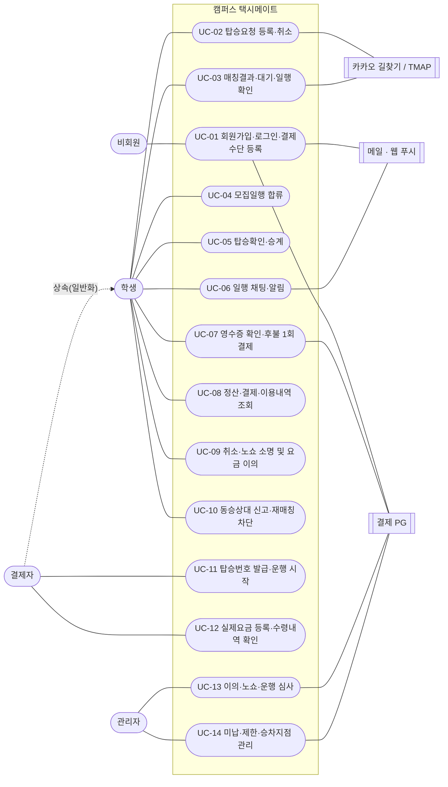

# 유스케이스 다이어그램 및 유스케이스 명세 (v2.0)

> **설계 원칙:**
> 1. **외부 처리 중심:** 스케줄러·조합 탐색·DB 저장·해시 검증 등 시스템 내부 처리를 유스케이스에서 제외한다.
> 2. **4액터 + 일반화(상속) 구조:** 주 액터를 `비회원`, `학생`, `결제자(학생 상속)`, `관리자`로 구성한다.
> 3. **요구사항 추적성:** 모든 유스케이스를 기능적 요구사항(`FR`) 및 시퀀스 다이어그램과 일관되게 연결한다.

---

## 1. 액터 정의

| 액터 | 구분 | 역할 |
|---|---|---|
| **비회원** | 주 액터 | 학교 이메일 인증 회원가입 및 로그인 |
| **학생** | 주 액터 | 결제수단 등록, 탑승 요청·취소, 매칭·일행 확인, 탑승 확인, 영수증 확인 및 후불 1회 결제, 정산·이용 내역 조회, 채팅·신고·소명·이의 제기 |
| **결제자** | 주 액터 *(학생 상속)* | 학생의 모든 기능을 상속하며, 실제 탑승 표시(탑승번호 발급)·운행 시작·실제 요금/영수증 등록·정산 수령 내역 확인을 추가 수행 |
| **관리자** | 주 액터 | 이의·노쇼·운행 분쟁 심사, 미납·미정산 확인, 신고·이용 제한 및 승차 지점 관리 |
| **카카오 길찾기 / TMAP** | 외부 시스템 | 도보 시간, 단독·일행 경로 및 예상 요금 조회 |
| **결제 PG (토스페이먼츠 등)** | 외부 시스템 | 결제수단 등록 및 정산 확정 후 1회 결제 승인·취소(분쟁 정정 시) |
| **메일 · 웹 푸시** | 외부 시스템 | 학교 이메일 인증 코드 발송 및 진행 알림 전송 |

---

## 2. 외부 처리 중심 UML 유스케이스 다이어그램

---

## 3. 유스케이스 명세 요약 (14개)

| ID | 유스케이스 | 액터 | 주요 흐름 (한 줄) | 외부 시스템 | 기능 요구 |
|---|---|---|---|---|---|
| **UC-01** | 회원가입·로그인·결제수단 | 비회원, 학생 | 학교 메일 코드 인증 → 비밀번호·성별·결제수단 등록 → 로그인·로그아웃·프로필 관리 | 메일, 결제 PG | `FR-A01~A05`, `FR-S01` |
| **UC-02** | 탑승요청 등록·취소 | 학생 | 승차 지점·목적지·시간 입력 → 도보·단독 요금 확인 → 요청 등록 또는 대기 취소 | 카카오, TMAP | `FR-R01~R04` |
| **UC-03** | 매칭결과·대기·일행 확인 | 학생 | 대기 상태 조회 → 자동 매칭 확정 결과·하차 순서·예상 분담금·경로 확인 | 카카오 | `FR-M01~M04` |
| **UC-04** | 모집일행 합류 | 학생 | 합류 가능 일행 조회 → 조건 재검증 후 기존 일행에 합류 확정 | 카카오 | `FR-M05` |
| **UC-05** | 탑승확인·승계 | 학생 | 승차 지점 도착 표시 → 결제자 6자리 탑승번호 입력 인증 → 필요 시 승계·운행 응답 | — | `FR-B01`, `FR-B03~B05` |
| **UC-06** | 일행 채팅·알림 | 학생 | 독립 메시지함에서 텍스트·사진·읽음 조율 및 매칭·탑승·정산 알림 수신·설정 | 메일, 웹푸시 | `FR-C01`, `FR-C02`, `FR-C04` |
| **UC-07** | 영수증 확인·후불 1회 결제 | 학생 | 등록된 실제 요금·영수증과 최종 분담금 확인 → `[확인하고 결제]` 1회 결제 (실패 시 재시도) | 결제 PG | `FR-S03`, `FR-S04`, `FR-S06` |
| **UC-08** | 정산·결제·이용내역 조회 | 학생 | 정산 결과·결제/미납 기록·지난 이용 내역·누적 절약액 확인 및 칭찬 등록 | — | `FR-S07`, `FR-S08`, `FR-C05`, `FR-C06` |
| **UC-09** | 취소·노쇼 소명·요금 이의 | 학생 | 미탑승 표시·24시간 탑승 소명 제출 또는 등록 요금·영수증 기한 내 이의 제기 | — | `FR-B06`, `FR-S05` |
| **UC-10** | 동승상대 신고·차단 | 학생 | 부적절한 동승상대 신고 접수 및 재매칭 차단 설정·해제 | — | `FR-C03` |
| **UC-11** | 탑승번호 발급·운행 시작 | 결제자 | 실제 택시 탑승 표시 → 6자리 탑승번호 발급(5분) → 기사님 안내 → 운행 시작 표시 | — | `FR-M04`, `FR-B02`, `FR-B04` |
| **UC-12** | 실제요금 등록·수령 확인 | 결제자 | 실제 택시요금·영수증 등록(확정 전 수정) → 정산·수납 후 모의 지급 수령액 확인 | — | `FR-S02`, `FR-S07` |
| **UC-13** | 이의·노쇼·운행 심사 | 관리자 | 증거·영수증·채팅·소명 검토 → 근거 입력 후 노쇼·요금·운행 판정 및 정산 확정 | 결제 PG | `FR-O01~O03` |
| **UC-14** | 미납·제한·승차지점 관리 | 관리자 | 미납·미정산 처리, 신고 기반 이용 제한/해제, 승차 지점 관리, 감사·정확도 조회 | 결제 PG | `FR-O04~O06` |

> **주요 예외 흐름 요약:**
> `UC-02` 결제수단 미등록·도보 10분 초과·API 장애 시 거절 · `UC-05/09` 번호 미입력은 노쇼 확정 금지, 24시간 소명 후 판단 불가 면책 · `UC-07` 금액 수정 시 이전 확인 무효화, 기한 내 미납 시 신규 요청 자동 제한 · `UC-13` 예상 요금 1.5배 초과/0.5배 미만 시 자동 확정 차단 후 관리자 심사

---

## 4. 핵심 유스케이스 상세 명세 (시퀀스 다이어그램 직결용 6종)

### UC-02 탑승요청 등록·취소 *(시퀀스 ① 연결)*
- **액터:** 학생 · **외부 시스템:** 카카오 길찾기, TMAP 보행자 · **관련 FR:** `FR-R01~R04`
- **사전조건:** 로그인 완료, 결제수단 등록 완료, 미납·이용 제한 및 중복 요청 없음
- **기본 흐름:**
  1. 학생이 공통 승차 지점, 하차 목적지, 출발 조건(예약/즉시)을 입력한다.
  2. 시스템이 TMAP 도보 시간과 카카오 단독 예상 요금을 조회해 미리보기로 표시한다.
  3. 학생이 조건을 확인하고 요청을 등록하면 `WAITING` 상태로 저장된다.
  4. 학생이 매칭 확정 전 취소를 선택하면 요청이 즉시 취소된다.
- **예외 흐름:** 결제수단 미등록, 도보 10분 초과, 중복 요청, TMAP/카카오 조회 실패 시 요청을 거절하고 입력을 유지한다.
- **사후조건:** 대기 요청이 생성되거나 취소 상태로 종료된다.

### UC-03 매칭결과·대기·일행 확인 *(시퀀스 ① 연결)*
- **액터:** 학생 · **외부 시스템:** 카카오 길찾기 · **관련 FR:** `FR-M01~M04`
- **사전조건:** `WAITING` 상태의 탑승 요청 존재
- **기본 흐름:**
  1. 학생이 대기 화면에서 현재 매칭 대기 상태를 조회한다.
  2. 조건(동성·2~4명·지연 ≤ 15분·탑승 전 예상 절약 ≥ 10%) 통과 시 일행이 확정된다.
  3. 학생은 하차 순서, 결제자, **예상 분담금**(참고값), 합승 경로를 확인한다.
- **예외 흐름:** 모집 마감까지 유효 조합이 없으면 미성사 알림과 단독 예상 요금을 안내한다. 인원 변경 시 조건을 재검사하고 무료 이탈 선택을 제공한다.
- **사후조건:** 일행이 출발 준비 상태(`READY`)로 확정되거나 미성사로 종료된다.

### UC-05 / UC-11 탑승 인증 및 운행 시작 *(시퀀스 ② 연결)*
- **액터:** 결제자(상속), 학생 · **외부 시스템:** 없음 · **관련 FR:** `FR-B01~B05`
- **사전조건:** 확정 일행의 승차 지점 집결
- **기본 흐름:**
  1. 일행원이 승차 지점 도착을 표시한다.
  2. 결제자가 실제 탑승을 표시하면 6자리 문자열 탑승번호(5분 기한)가 결제자 화면에만 표시된다.
  3. 동승자가 5분 내(최대 5회 시도) 번호를 입력해 본인 탑승을 인증한다.
  4. 결제자가 운행 시작을 명시적으로 표시한다.
- **예외 흐름:** 결제자 부재 시 다음 하차 동승자에게 승계를 요청하며 기존 번호는 즉시 폐기한다. 번호 미입력자는 즉시 노쇼 확정하지 않고 24시간 소명 조사 대상으로 전환한다.
- **사후조건:** 운행 완료 후 실제 요금 입력 대기(`AWAITING_FARE`)로 전이.

### UC-12 / UC-07 실제요금 등록 · 영수증 확인 및 후불 1회 결제 *(시퀀스 ③ 연결)*
- **액터:** 결제자(상속), 학생 · **외부 시스템:** 결제 PG · **관련 FR:** `FR-S02~S04`, `FR-S06`, `FR-S07`
- **사전조건:** 운행 시작 완료 및 결제자 택시비 현장 결제
- **기본 흐름:**
  1. 결제자가 실제 택시요금과 영수증 사진을 등록한다(`정산 v1`).
  2. 시스템이 단독 예상 요금 비율로 개인별 **최종 분담금**을 계산해 동승자에게 알린다.
  3. 동승자가 영수증과 최종 분담금을 확인하고 **`[확인하고 결제]`** 를 눌러 등록 결제수단으로 1회 결제를 완료한다.
  4. 동승자 전원 확인 시 즉시 정산 금액이 확정되고, 수납 완료분은 결제자 **모의 지급 장부**에 기록된다.
- **예외 흐름:**
  - 결제자가 금액을 수정하면 정산 버전이 증가(`v2`)하고 기존 확인은 무효화된다.
  - 무응답 시 **6시간 경과 후 금액 자동 확정** 및 결제 대기(24시간 내 미납 시 신규 요청 제한 + 관리자 미정산 이관).
  - 예상 요금 1.5배 초과/0.5배 미만 또는 이의 제기 시 자동 확정을 멈추고 관리자 심사로 전환한다.
- **사후조건:** `정산 확정 → 결제 완료 → 모의 지급 기록` 완료 및 7일 뒤 영수증 삭제 예약.

### UC-13 이의·노쇼·운행 심사 *(시퀀스 ③ 연결)*
- **액터:** 관리자 · **외부 시스템:** 결제 PG(필요 시) · **관련 FR:** `FR-O01~O03`
- **사전조건:** 관리자 권한 로그인, 검토 대기 조사/이의/운행 건 존재
- **기본 흐름:**
  1. 관리자가 대상 건의 증거(소명·동료 표시·영수증·최근 채팅)를 조회한다.
  2. 필수 판정 근거(최대 2,000자)를 입력하고 판정(노쇼 확정/아님/판단 불가, 이의 인정/기각, 운행/미운행)을 확정한다.
  3. 시스템이 감사 로그를 기록하고 최종 분담금·노쇼 보전 청구를 반영한다.
- **예외 흐름:** 판단 불가(`UNDETERMINED`)는 노쇼 면책으로 처리한다. 보관 만료 영수증은 `증거 없음`으로 표시하며 미운행 근거로 삼지 않는다.
- **사후조건:** 분쟁 종결, 감사 이력 저장, 정산 확정.
