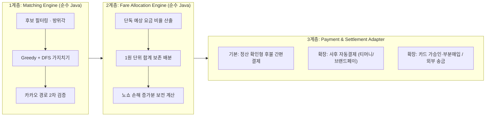

# 핵심 아키텍처 및 정산 정책 설계서 (v2.0)

> **문서 목적:** 자동 매칭·분담금 계산·결제/정산 3계층 구조와 **"왜 적립금·선결제를 폐기하고 확인형 후불 1회 결제로 수렴했는가(ADR)"**, 그리고 **상태 분리·동시성·예외 규칙**을 최종 확정한다.

---

## 1. 3계층 독립 아키텍처 (도메인 보호 설계)

결제 PG 정책이나 법적 환경이 바뀌더라도 핵심 매칭·분담 로직이 흔들리지 않도록 세 계층을 분리한다.



- **1계층 (`matching-engine/` — 고정):** DB·Spring·외부 API 비의존 순수 Java. `C8`에서 회차별 완전탐색 최적해 대비 손실 `0.00~0.03%p`(2,261회 중 3회만 차선), `C11`에서 `4명 조기 확정 + 2~3명 마감 대기` 우위 검증, `C13`에서 지연 15분·절약 10%가 8/9개 조건 파레토 경계 위임을 확인.
- **2계층 (`SettlementCalculator` — 고정):** 단독 예상 요금 비율 배분 + 1원 미만 버림 후 소수부 큰 순 동승자 배분(합계 불일치 0건).
- **3계층 (`PaymentGateway` / `SettlementService` — 교체 가능):** 결제 방식이 바뀌어도 1·2계층 코드와 알고리즘 검증은 그대로 유지된다.

---

## 2. 정산 정책 아키텍처 의사결정 기록 (ADR — 왜 후불 1회 결제인가?)

### 검토한 대안과 기존 실험(C10·C11·C14)의 실증 근거

| 대안 | 탑승 전 결제 | 정상 이용 환불/추가 | 운영자 요금 리스크 | 미납 방어 | 채택 여부 및 근거 |
|---|---|---|---|---|---|
| **① 115~125% 선결제 + 사후 정산** | 115~125% | **환불 77~95% / 추가 5~23%** (`C10`) | 없음 | 강함 | **폐기** — 정상 이용의 대부분에서 부분환불·지연 발생 |
| **② 확정 분담금 + 적립금 (구 S43)** | 101% | 0% / 0% | **있음** (`C14`: 35건 최대 ~19.5만, 100건 ~82.5만) | 강함 | **폐기** — 일행 59~70%가 실제보다 초과 납부, 운영자 보험 구조가 부자연스럽고 설명 복잡 |
| **③ 카드 가승인(Hold) + 1회 부분매입** | 한도 보류 | 0% / 0% | 없음 | 강함 | **상용 확장 후보** — 국내 일반 PG의 부분매입 계약 제약 |
| **④ 예치금(보증금) 잠금** | 사전 충전 | 0% / 0% | 없음 | 최강 | **폐기** — 선불전자지급수단 규제 + 초기 충전 진입장벽 |
| **⑤ 외부 직접 송금 (앱 결제 없음)** | 없음 | 없음 | 없음 | 약함 | **경량 대안** — 미납·노쇼 통제 불가 |
| **⑥ 정산 확인형 후불 1회 간편결제 *(+ 자동결제 확장)*** | **0원 (결제수단만 등록)** | **0% / 0%** | **없음 (`차액 수지 = 0`)** | 중~강 *(결제수단 등록 + 학교계정 제한)* | **최종 채택** — 적립금 폐지, 초과 납부 0명, 부분환불 0건, 영수증 확인과 결제 1버튼 통합 |

### 최종 채택 3대 정산 원칙
1. **적립금·보험 구조 폐지:** 정상 운행 시 `Σ 최종 분담금 = 인정된 실제 택시요금`, `운영자 요금 차액 수지 = 0`.
2. **실제 택시요금 비율 정산:** `최종 분담금 P_i = 인정된 실제 요금 F × (단독 예상 요금 S_i / Σ S_j)`.
3. **정상 이용 시 후불 1회 결제:** 탑승 전에는 결제수단 등록만 요구하고, 운행 후 영수증 확인과 동시에 최종 분담금만 1회 결제한다.

---

## 3. 확인 기반 조기 정산 & 3단계 상태 분리

### 정산·결제·지급 3단계 명확한 분리
실제 PG 정산은 동승자 카드 승인이 곧바로 결제자 계좌 입금으로 이어지지 않는다(매입·정산 잔액 확보 및 영업일 08~15시 지급 요청 제약). 따라서 시스템 상태를 3단계로 엄격히 분리한다.

```text
[1. 정산 확정 (금액 합의)] ──▶ [2. 결제 완료 (동승자 수납)] ──▶ [3. 지급 완료 (결제자 모의 지급)]
   전원 확인 즉시 / 6시간 무응답      [확인하고 결제] 1회 승인           수납 확보분 장부 기록 (실송금 없음)
```

### 정산 버전 경합 및 안전 조건
| 상황 | 시스템 처리 |
|---|---|
| 동승자 전원 `[확인하고 결제]` + 정상 요금 + 조사 없음 | **즉시 정산 확정** 및 결제 완료 → 결제자 모의 지급 기록 |
| 일부 무응답 + 정상 요금 + 조사 없음 | **6시간 경과 시 금액 자동 확정** → 미결제 동승자는 결제 대기(24시간 기한) |
| 결제자가 실제 요금·영수증 수정 | **정산 `version` 증가**, 이전 버전의 확인 무효화, 동승자 재확인 요청 |
| 요금 이의 제기 또는 탑승 미확인 조사 진행 중 | 자동 확정 즉시 중단 → **관리자 심사** |
| 예상 요금 `1.5배 초과` 또는 `0.5배 미만` | 자동 확정 차단 → **관리자 영수증 심사** |
| 동승자 결제 실패 / 24시간 미납 | **신규 동승 요청 자동 제한** + 관리자 미정산 이관. 타 일행 전가·운영자 자동 보전 금지. 확보된 수납분은 구분 기록 |
| PG 승인 응답 유실 / 일시 장애 | 멱등키 기반 최대 3회 상태 조회, 확인 전까지 `완료` 표시 금지 |

> **상용 자동결제 확장 경로:** 티머니모빌리티 PG(모빌리티 비주기 자동결제 명시) 또는 토스페이먼츠 브랜드페이 자동결제 계약이 확보되면, 무응답 6시간 경과 시 등록 결제수단으로 자동 청구를 연결할 수 있도록 `PaymentGateway` 인터페이스를 유지한다.

---

## 4. 취소 · 노쇼 · 결제자 승계 정책

- **목적:** 노쇼 처리는 처벌이나 플랫폼 수익이 아니라 **남은 일행의 실제 손해를 줄이는 것**이다.
- **무료 취소:** 출발 전 허용 기한 내 취소 시 페널티 없음, 남은 일행의 지연·절약 조건 재검사.
- **탑승 인증 (S45 유지):** 도착 표시 ≠ 실제 탑승 ≠ 운행 시작. 결제자 실제 탑승 시 6자리 문자열 5분 창 개방(5회 오입력 제한). 승계 시 이전 번호 즉시 무효, 이미 인증된 동승자 기록은 보존.
- **노쇼 판정 보호:** 번호 미입력만으로 노쇼 확정 금지 → 24시간 소명 + 동료 확인 + 관리자 심사. **판단 불가(`UNDETERMINED`)는 노쇼 면책.**
- **노쇼 보전 (후불 모델 적용):** 노쇼 최종 확정 시, 남은 일행이 이탈자 때문에 추가로 부담한 인정 손해분(`SettlementCalculator` 보전 계산)을 노쇼자에게 보전 결제 청구한다(미납 시 신규 요청 제한 + 관리자 미정산 관리).

---

## 5. 사용자 상태 투영 모델 (`TripViewModel` — Taximate 3.0 연계)

백엔드의 16개 내부 `PartyStatus`를 학생 화면에 그대로 노출하지 않고, 사용자 중심 **6단계 진행 상태 + 역할별 다음 할 일(`ActionPanel`)** 로 투영한다.

| 사용자 표시 단계 | 동승자 주요 행동 | 결제자 주요 행동 | 예외·차단 안내 |
|---|---|---|---|
| **1. 매칭 대기** | 대기 상태 확인 / 요청 취소 | — | 미성사 시 단독 요금 안내·재요청 |
| **2. 일행 확정 · 탑승 준비** | 승차 지점 이동 / 도착 표시 | 택시 호출 준비 / 기사님 안내 화면 / 도착 표시 | 인원 변경 시 무료 이탈, 결제자 부재 시 승계 |
| **3. 탑승 인증** | 결제자 6자리 탑승번호 입력 | 실제 탑승 표시(번호 발급) → 운행 시작 표시 | 미입력은 조사 대상(즉시 노쇼 금지) |
| **4. 운행 중** | 운행 안내 확인 | 도착 후 실제 요금·영수증 입력 준비 | 출발 미표시 시 운행 여부 응답 |
| **5. 정산 확인 · 결제** | 영수증 확인 + **`[확인하고 결제]`** (또는 이의) | 실제 요금·영수증 등록/수정, 수납 현황 확인 | 1.5배 이상·이의·조사 시 관리자 검토 |
| **6. 이용 완료** | 최종 분담금·영수증·결제 기록 확인 | 모의 지급 수령 내역 확인 | 실제 송금 없음 명시, 미납 시 재결제·제한 안내 |

---

## 6. 현행 저장소 코드(S43) → v2.0 전환 델타 요약

현재 저장소 `main`은 직전 S43(확정 분담금 선결제 + 적립금)으로 구현·테스트되어 있다. 향후 구현 단계로 넘어갈 때 변경 대상과 보존 대상은 아래와 같다.

| 영역 | 조치 | 세부 대상 |
|---|---|---|
| **보존 (변경 없음)** | 1·2계층 핵심 엔진, 인증·채팅·탑승번호·관리자 | `matching-engine/`, `BoardingCodeService`, `PartyChatService`, `AdminService`, `MemberSafetyService`, `NoShowService` |
| **수정 (3계층 전환)** | 선결제·적립금 제거 → 결제수단 등록 + 확인형 후불 1회 결제 | `PaymentService`, `PaymentLifecycleService`, `SettlementService`(확인·버전·6시간 자동확정), `ReserveEntry` 비활성화 |
| **UI 개편 (Taximate 3.0)** | 소비자 예약형 IA + 4레이아웃 격리 + 후불 확인 화면 | `frontend/src/` (PR 1~6) |
| **제거/정리 대상** | 과거 구 방식 잔재 | `LegacyPartyScreens.jsx`, 구 송금 API(`/transfers/{id}/sent|received`), 적립금 안내 문구 |
